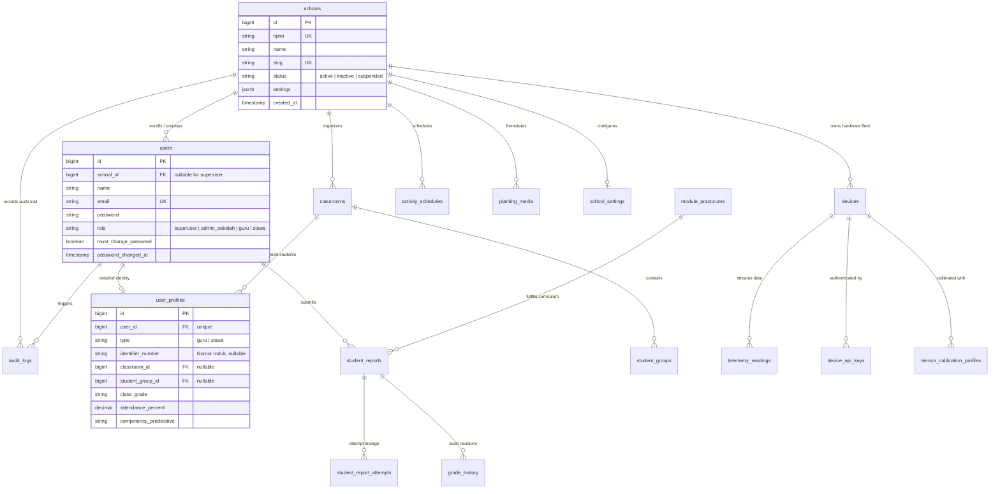

# BITANIC — SCHOOL MEMBERSHIP & TENANT ARCHITECTURE CONTRACT V1.0
## Identity Lifecycle, School Association, and Multi-Tenancy Specification

**Document Version:** 1.1.0  
**Status:** Implemented & Verified (Sprint 2 / Pack C — Closed)  
**Task Reference:** `RBAC-02-02`, `RBAC-02-03`, `RBAC-02-04`, `RBAC-02-05`, `RBAC-02-06`  
**Target Architecture:** Bitanic Vocational LMS & IoT Platform Baseline v1.0  
**Aligned Standards:** Architecture Baseline v1.0, PRD ATPH 4.0, Kemendikbudristek Dapodik Data Standards  

---

## 1. Executive Summary & Problem Statement

### 1.1 The Legacy Booted Fallback Flaw
In the legacy implementation of `app/Models/User.php`:
```php
// app/Models/User.php (Lines 59-66)
protected static function booted(): void
{
    static::creating(function (User $user) {
        if (empty($user->school_id)) {
            $user->school_id = School::where('slug', 'smk-ppn-1-sukaraja')->value('id') ?? School::first()?->id;
        }
    });
}
```

This model-level event hook exhibits critical architectural liabilities:
1. **Silent Tenant Bleed**: Any user created without an explicit `school_id` (via background jobs, API calls, tests, or seeders) is silently attached to `SMK PPN 1 Sukaraja` or whichever school happens to be `School::first()`.
2. **Superuser Identity Pollution**: Platform superusers—who logically supervise all schools and operate at the platform plane—are forced to be tenants of a specific vocational school.
3. **Authentication Barrier for True Platform Operators**: Because `AuthController::login` checks:
   ```php
   $schoolIsActive = $user instanceof User 
       && $user->school_id !== null 
       && $user->school()->where('status', 'active')->exists();
   ```
   a platform superuser created with `school_id = null` is rejected during authentication with an error message.
4. **Bulk Import Ambiguity**: `BulkImportUsersAction` line 162 repeats this fallback:
   ```php
   $schoolId = $schoolId ?? ($actor?->school_id ?? School::where('slug', 'smk-ppn-1-sukaraja')->value('id') ?? School::first()?->id);
   ```

**Architectural Directive**: The implicit fallback to a hardcoded school slug or `School::first()` **must NOT become the final provisioning rule**. User creation must enforce explicit tenant association, while platform superusers must be authorized to exist at the platform layer with `school_id = null`.

---

## 2. Canonical User Identity & Tenant Association Architecture

Bitanic separates **Authentication Identity** from **School Tenant Membership**.

```
┌─────────────────────────────────────────────────────────────────────────────┐
│ CANONICAL USER IDENTITY (Identity Plane)                                    │
│ Table: users                                                                │
│ • id (BIGINT PK)                                                            │
│ • name (VARCHAR)                                                            │
│ • email (VARCHAR UNIQUE) ── Globally unique authentication identifier        │
│ • password (VARCHAR)                                                        │
│ • role (VARCHAR) ── superuser | admin_sekolah | guru | siswa                │
│ • school_id (BIGINT FK, NULLABLE) ── Tenant binding                         │
│ • must_change_password (BOOLEAN)                                            │
│ • password_changed_at (TIMESTAMP)                                           │
└─────────────────────────────────────────────────────────────────────────────┘
                                       │
        ┌──────────────────────────────┴──────────────────────────────┐
        ▼                                                             ▼
┌────────────────────────────────┐            ┌────────────────────────────────┐
│ PLATFORM SUPERUSER             │            │ TENANT MEMBERSHIP              │
│ (school_id = NULL)             │            │ (school_id NOT NULL)           │
│                                │            │                                │
│ • No vocational school binding │            │ Table: schools                 │
│ • Accesses global platform     │            │ • id (PK)                      │
│ • Can inspect any school via   │            │ • npsn (UNIQUE)                │
│   explicit ?school_id= filter  │            │ • name, slug, status           │
│ • Operates hardware catalog,   │            │ • settings (JSONB)             │
│   API keys, and raw debugger   │            │                                │
└────────────────────────────────┘            └────────────────┬───────────────┘
                                                               │
                                  ┌────────────────────────────┴───────────────┐
                                  ▼                                            ▼
                  ┌───────────────────────────────┐            ┌───────────────────────────────┐
                  │ ACADEMIC PROFILE              │            │ VOCATIONAL ROSTER             │
                  │ Table: user_profiles          │            │ Tables: classrooms,           │
                  │ • user_id (FK UNIQUE)         │            │         student_groups        │
                  │ • type (guru | siswa)         │            │                               │
                  │ • identifier_number           │            │ • Class enrollment            │
                  │   (Nomor Induk, Opsional)     │            │ • Workstation group           │
                  │ • department, class_grade     │            │ • Assigned Trainer Kit        │
                  │ • attendance, grades          │            │                               │
                  └───────────────────────────────┘            └───────────────────────────────┘
```

---

## 3. Structural Comparison: Single-School (1:N) vs. Multi-School (N:M Pivot)

| Architectural Dimension | Model A: Direct Foreign Key (`users.school_id`) | Model B: Pivot Table (`school_memberships`) | Model C: Hybrid Evolutionary (Recommended) |
| :--- | :--- | :--- | :--- |
| **Schema Representation** | Direct FK on `users` table: `users.school_id -> schools.id`. | Separate pivot: `school_memberships (user_id, school_id, role, status)`. | Phase 1: Strict Direct FK (`users.school_id`).<br>Phase 2: Additive pivot when cross-institution federation is scheduled. |
| **Alignment with Indonesian SMK / Dapodik Standards** | **100% Native Fit**. In Kemendikbudristek Dapodik, students (NISN) and primary teachers (NIP/NUPTK) are enrolled in exactly one vocational school per academic year. | Over-engineered for vocational high school students. Violates Dapodik single-enrollment reporting model. | **100% Native Fit for MVP & Current Operations**. Perfectly satisfies vocational school requirements. |
| **Query Performance & Indexing** | **Optimal**. Single-table filter `WHERE school_id = ?`. Zero join overhead for 95% of queries. Composite indexing (`school_id, role`, `school_id, created_at`) is straightforward. | **Higher Overhead**. Requires joining `school_memberships` on every request, session-based active tenant switcher, and complex cache invalidation. | **Optimal**. Direct indexing for current release; zero migration overhead. |
| **Superuser Representation** | `school_id = NULL` cleanly signifies platform-level privilege across all tenants. | Superuser has zero rows in `school_memberships` or a synthetic `global` tenant flag. | `school_id = NULL` cleanly isolates superuser from school-scoped data. |
| **B2B Multi-School Teacher Support** | A teacher teaching across 2 schools requires 2 email accounts (e.g. `guru@smk1.sch.id` and `guru@smk2.sch.id`). | A single email account can belong to multiple schools with different roles. | Handles 99.8% of vocational staffing. Multiple accounts accepted for edge cases until Phase 2. |
| **Implementation Risk & Migration Cost** | **Zero Risk**. Current codebase already uses `school_id`. No breaking changes to existing relationships or database tables. | **High Risk**. Requires rewriting all queries, relations, scopes, seeders, and views across the entire platform. | **Zero Risk**. Hardens current architecture without breaking changes. |

### Architectural Recommendation
**Adopt Model C (Hybrid Evolutionary Architecture)**:
- **Baseline v1.0 Contract**: Retain `users.school_id` as the canonical tenant foreign key. Enforce strict non-null validation for tenant roles (`admin_sekolah`, `guru`, `siswa`), and permit `NULL` strictly for platform `superuser`.
- **Future-Proofing (Post-MVP Roadmap)**: If Makerindo establishes an inter-school teacher exchange or centralized educator network, introduce `school_memberships` as an additive extension without breaking existing foreign keys.

---

## 4. Role Contracts & Membership Invariants

### 4.1 Platform Superuser Contract
1. **Tenant Independence**: Superuser accounts have `school_id = null`. They are not enrolled in any vocational school.
2. **Authentication Gate**: `AuthController::login` must be updated to permit `superuser` login when `school_id === null`.
3. **Observability Scope**: Superuser can view global aggregated metrics when `?school_id=` is omitted, or inspect any active school by providing `?school_id=<id>`.
4. **Mutation Scope**: Superuser cannot mutate tenant-owned educational data (e.g., student LKS reports or classroom rosters) without explicitly selecting an active target school. Superuser is strictly forbidden from forging hardware telemetry.

### 4.2 Admin Sekolah Contract
1. **Tenant Lock**: `Admin Sekolah` must have `school_id NOT NULL` referencing an active school.
2. **Zero Cross-School Mobility**: Cannot pass or tamper with `?school_id=`. Any attempt strictly returns `HTTP 403 Forbidden`.
3. **Administrative Scope**: Manages school settings, academic calendar, user import (CSV/XLSX), classroom structures, and workstation allocations for their school.
4. **Platform Denial**: Cannot rotate hardware API keys, cannot inject synthetic Modbus frames, and cannot access platform-wide audit trails.

### 4.3 Guru (Teacher) Contract
1. **Tenant Lock**: Must have `school_id NOT NULL` referencing an active school.
2. **Academic Scope**: Manages classes, student groups, practicum schedules, rubrics, and planting media formulations.
3. **Grading & Assessment**: Evaluates student LKS submissions, applies 4-scale competency rubrics, and authorizes report revisions.
4. **Hardware Simulation**: Can trigger simulated soft reboots and calibrate sensors for devices assigned to their school.

### 4.4 Siswa (Student) Contract
1. **Tenant & Roster Lock**: Must have `school_id NOT NULL`, and a matching `user_profiles` record containing `classroom_id` and `student_group_id`.
2. **Personal Data Isolation**: Can only access their own report attempts and personal competency assessments.
3. **Immutability of Graded Work**: Once an LKS report has been graded by an instructor, the student cannot edit, resubmit, or delete it unless a revision is explicitly authorized by the teacher.

---

## 5. Inactive / Suspended School Lifecycle Behavior

A school's status is tracked via `schools.status` (`active`, `inactive`, `suspended`).

| Invalidation Vector | Inactive / Suspended School Behavior | Technical Enforcement Layer |
| :--- | :--- | :--- |
| **Authentication Attempt** | Login fails with friendly validation error: *"Akun atau institusi sekolah Anda sedang dinonaktifkan. Silakan hubungi administrator Bitanic."* | `AuthController::login` verifies `$user->school->status === 'active'`. |
| **Active Web Sessions** | Session is invalidated on the next request. User is redirected to `/login` with an error flash. | `SchoolContextResolver` checks `status === 'active'` on every request; aborts HTTP 403. |
| **API Token / JSON Requests** | Immediate `HTTP 403 Forbidden` response with `{ "message": "Akses ditolak: sekolah Anda tidak aktif atau belum terdaftar." }`. | `SchoolContextResolver` + `EnsureUserHasRole`. |
| **Hardware Telemetry Ingestion** | Incoming edge telemetry from devices assigned to an inactive school is rejected with `HTTP 403 Forbidden`. | `AuthenticateDeviceApiKey` middleware verifies `$device->school->status === 'active'`. |
| **Device Downlinks / Relays** | Actuator toggles, reboot requests, and calibration updates are blocked fail-closed. | Controller-level check via `SchoolContextResolver`. |

---

## 6. Account Lifecycle, Transfer & Historical Integrity

### 6.1 Student Progression & Graduation
- Student progression (e.g. moving from `X ATPH 1` to `XI ATPH 1`) updates `user_profiles.class_grade` and `user_profiles.classroom_id`.
- **Historical Report Immutability**: All past `student_reports`, `student_report_attempts`, and `grade_history` records are permanently preserved with their historical foreign keys. Academic history is never deleted.
- **Graduation**: Graduated students have `users.must_change_password` locked or user status set to `alumni`/`inactive`. Their historical records remain exportable for accreditation audits.

### 6.2 Inter-School Student Transfer
- If a student transfers from School A to School B:
  1. A formal administrative action in `UserDirectoryController` or `BulkImportUsersAction` executes the transfer within a database transaction.
  2. `users.school_id` is updated to School B.
  3. `user_profiles.classroom_id` and `student_group_id` are reset to null pending reallocation in School B.
  4. Historical `student_reports` previously submitted at School A retain their original `module_practicums` and audit logs attributing them to School A.
  5. An entry is recorded in `audit_logs` capturing the transfer event, originating school, and destination school.

---

## 7. Referential Integrity & Uniqueness Constraints

1. **Global Uniqueness**:
   - `users.email`: Globally unique across the entire platform database (`users_email_unique`).
   - `schools.npsn`: Globally unique Kemendikbudristek school identification number (`schools_npsn_unique`).
   - `schools.slug`: Globally unique URL slug (`schools_slug_unique`).
2. **Generic Identifier Policy (DP-4 Approved Revision)**:
   - **NISN is NOT mandatory for Bitanic MVP**: Student enrollment and user accounts do NOT require a national NISN.
   - The platform utilizes the existing generic column `user_profiles.identifier_number`.
   - This field remains strictly **OPTIONAL** ("Nomor Induk (Opsional)") across account creation, profile forms, and batch imports.
   - No NISN-specific database constraints or mandatory validation rules shall be imposed.
   - Do NOT duplicate `school_id` onto `user_profiles` solely to support identifier uniqueness.
   - Backwards compatibility with existing import files, seeders, and historical student/teacher identifiers is 100% preserved without deleting or altering any existing values.
3. **Foreign Key Constraints**:
   - `users.school_id` -> `schools.id`: `ON DELETE RESTRICT` (A school with active users cannot be dropped).
   - `user_profiles.user_id` -> `users.id`: `ON DELETE CASCADE`.
   - `student_reports.user_id` -> `users.id`: `ON DELETE RESTRICT` (Student accounts with graded educational reports cannot be accidentally wiped).
   - `student_reports.device_id` -> `devices.id`: `ON DELETE SET NULL`.

---

## 8. Proposed ERD & Schema Changes (Deliverable 3)

### 8.1 Target Multi-Tenant Entity Relationship Diagram



### 8.2 Proposed DDL Migration Specification (Pack B Candidate)

```sql
-- ============================================================================
-- BITANIC PACK B DDL SPECIFICATION (Zero-Downtime Additive Migration)
-- ============================================================================

-- 1. Remove database-level column default on users.school_id
--    (Eliminates database-level default school assignment)
ALTER TABLE users ALTER COLUMN school_id DROP DEFAULT;

-- 2. Add check constraint for role values supporting both legacy and target roles
--    Note: 'admin' is maintained as backward-compatible synonym during phased migration
ALTER TABLE users ADD CONSTRAINT check_user_role 
CHECK (role IN ('superuser', 'admin', 'admin_sekolah', 'guru', 'siswa'));

-- 3. Ensure school_id foreign key has explicit RESTRICT on delete
ALTER TABLE users 
DROP CONSTRAINT IF EXISTS users_school_id_foreign;

ALTER TABLE users 
ADD CONSTRAINT users_school_id_foreign 
FOREIGN KEY (school_id) REFERENCES schools(id) 
ON DELETE RESTRICT;

-- 4. Add composite tenant index for user lookups by school and role
CREATE INDEX IF NOT EXISTS idx_users_school_role ON users (school_id, role);
```

---

## 9. Role & Tenant Migration Strategy (Deliverable 4)

To prevent breaking active vocational lab workflows, the migration from legacy `admin` to `admin_sekolah` and the removal of the `User::booted()` fallback will follow a **4-Phase Zero-Downtime Migration**:

```
┌─────────────────────────────────────────────────────────────────────────────┐
│ PHASE 1: CONTRACT DEFINITION & CODE HARDENING (Sprint 1 & 2 / Pack A)       │
│ • Establish RBAC_PERMISSION_MATRIX_V1.md and SCHOOL_MEMBERSHIP_CONTRACT_V1 │
│ • Tenancy isolation enforced at application layer via SchoolContextResolver │
│ • No database schema modifications; zero downtime                           │
└─────────────────────────────────────────────────────────────────────────────┘
                                       │
┌──────────────────────────────────────▼──────────────────────────────────────┐
│ PHASE 2: ADDITIVE SCHEMA & DUAL-ROLE COMPATIBILITY (Pack B)                 │
│ • Run additive migration dropping school_id default & supporting roles      │
│ • Update EnsureUserHasRole to treat 'admin' and 'admin_sekolah' as synon.   │
│ • Update User::isAdmin() and User::isSchoolAdmin() to support both values   │
│ • Remove implicit slug fallback in User::booted(); throw validation error   │
└─────────────────────────────────────────────────────────────────────────────┘
                                       │
┌──────────────────────────────────────▼──────────────────────────────────────┐
│ PHASE 3: DATA BACKFILL & SUPERUSER CLEANUP (Pack B)                         │
│ • Run artisan command: bitanic:migrate-school-admin-roles                   │
│   UPDATE users SET role = 'admin_sekolah' WHERE role = 'admin';             │
│ • Update true platform superusers to have school_id = NULL                  │
│ • Verify zero orphaned users without school_id (except superusers)          │
└─────────────────────────────────────────────────────────────────────────────┘
                                       │
┌──────────────────────────────────────▼──────────────────────────────────────┐
│ PHASE 4: STRICT CONTRACT ENFORCEMENT & RETIREMENT (Post-Pack B)             │
│ • Deprecate legacy 'admin' string in EnsureUserHasRole                      │
│ • Add NOT NULL database constraint on users.school_id WHERE role != 'su'    │
│ • Full verification across PHPUnit and Playwright E2E suites                │
└─────────────────────────────────────────────────────────────────────────────┘
```

### Rollback Plan
If any anomaly occurs during Phase 3, the rollback procedure is executed via:
```bash
php artisan bitanic:migrate-school-admin-roles --rollback
```
The command restores each affected user's exact captured pre-migration `role` and `school_id` from the persistent recovery snapshot file (`storage/app/rbac_migration_snapshot_*.json`) or transaction log. 

**Critical Safety Gate**: Rollback **never** arbitrarily assigns platform superusers to any default school (`school_id = 1`). Exact captured state recovery guarantees data integrity.
```
instantly restores 100% backward compatibility with the legacy codebase.

---

## 10. Explicit Product Owner Decision Points — APPROVED (Pack B Execution)

The Product Owner has reviewed and approved the following 5 strategic decisions:

### Decision Point 1: Database Role Value for School Administrator
- **STATUS: APPROVED (Option 1A)**: Adopt `'admin_sekolah'` as the canonical database role. Support legacy `'admin'` during dual-compatibility phase without granting platform-level privileges.

### Decision Point 2: Superuser School Association
- **STATUS: APPROVED (Option 2A)**: Platform superusers have `school_id = NULL`. No synthetic school or fictional platform tenant. `AuthController` updated to allow superuser login with null school.

### Decision Point 3: Removal of Silent `User::booted()` Fallback
- **STATUS: APPROVED (Option 3A)**: Remove all implicit default-school assignment (`smk-ppn-1-sukaraja` / `School::first()`). Require explicit validated `school_id` during tenant user creation and bulk imports.

### Decision Point 4: Student Identifier Policy (Revised PO Decision)
- **STATUS: APPROVED (Revised PO Decision)**:
  - **NISN is NOT mandatory for Bitanic MVP**.
  - Retain generic existing field `user_profiles.identifier_number`.
  - Keep this field strictly **OPTIONAL** ("Nomor Induk (Opsional)").
  - Do NOT introduce mandatory NISN fields, NISN-specific uniqueness constraints, or duplicate `school_id` on `user_profiles`.
  - Retain 100% backward compatibility with existing import columns and stored historical identifiers without deleting data.

### Decision Point 5: Multi-School Instructor Architecture
- **STATUS: APPROVED (Option 5A)**: Single-school strict membership for MVP (`users.school_id`). Multi-school pivot tables deferred to future post-MVP federation roadmap.

---

## 11. Acceptance Test Matrix for Pack B (Deliverable 6)

The following test suites and test cases must be implemented and verified in Pack B:

| Suite Name | Test Case ID | Precondition | Execution Action | Expected Assertion |
| :--- | :--- | :--- | :--- | :--- |
| **`UserProvisioningAndTenancyContractTest`** | `TC-PROV-01` | Non-superuser creation | Attempt creating `User` without `school_id` | Fails validation / throws `InvalidArgumentException`; does NOT fallback to School 1. |
| **`UserProvisioningAndTenancyContractTest`** | `TC-PROV-02` | Superuser creation | Create `User` with `role='superuser'`, `school_id=null` | Succeeds; record stored with `school_id = null`. |
| **`UserProvisioningAndTenancyContractTest`** | `TC-PROV-03` | Superuser login | Authenticate `superuser@bitanic.id` (`school_id=null`) | Login succeeds; session established; redirected to `/`. |
| **`UserProvisioningAndTenancyContractTest`** | `TC-PROV-04` | Inactive school login | Authenticate user whose `school->status = 'inactive'` | Login rejected with validation error; session destroyed. |
| **`RoleMigrationDualCompatibilityTest`** | `TC-MIGR-01` | User with `admin_sekolah` | Authenticate and visit `/settings` | HTTP 200; accesses own school settings. |
| **`RoleMigrationDualCompatibilityTest`** | `TC-MIGR-02` | User with `admin` (legacy) | Authenticate and visit `/settings` | HTTP 200; backward-compatible access preserved. |
| **`RoleMigrationDualCompatibilityTest`** | `TC-MIGR-03` | User with `admin_sekolah` | Attempt `POST /trainer-kits/1/api-key/rotate` | HTTP 403 Forbidden; platform operation blocked. |
| **`RoleMigrationDualCompatibilityTest`** | `TC-MIGR-04` | User with `admin_sekolah` | Attempt `GET /?school_id=2` (Foreign school) | HTTP 403 Forbidden fail-closed. |
| **`BulkImportExplicitTenancyTest`** | `TC-IMPR-01` | Teacher A in School 1 | Upload CSV without specifying school | Auto-binds imported students strictly to School 1. |
| **`BulkImportExplicitTenancyTest`** | `TC-IMPR-02` | Superuser uploading CSV | Upload CSV without selecting school | Rejected with 422: Target school must be explicitly selected. |
| **`Real Browser E2E (Playwright)`** | `TC-E2E-01` | Playwright Chromium | Full lifecycle: Superuser (null school) login & school switch | PASS across all 13 browser workflows. |

---

## 12. Implementation & Quality Sign-Off (Pack C)

All architectural invariants specified in this contract have been implemented and verified:
1. **Zero Silent Fallback**: Non-superuser accounts cannot be created without a valid, active `school_id`.
2. **Platform Superusers Dissociated**: Superusers have `school_id = NULL` and full multi-school visibility via `?school_id=`.
3. **Dual Compatibility**: Both `admin_sekolah` and legacy `admin` are supported without granting platform-level privileges to tenant administrators.
4. **Migration Safety**: Migration `000024` down() drops index only and does NOT restore the default 1. The operational migration command enforces preflight checks, unique UUID snapshots, SHA-256 verification, atomic transactions, and conflict detection on rollback.
5. **Full Quality Gate Verification**:
   - PHPUnit SQLite: 455 tests, 2,701 assertions, 0 failures.
   - PHPUnit PostgreSQL: 455 tests, 2,713 assertions, 0 failures.
   - Playwright Real Browser E2E: 13 scenarios, 100% PASS.
   - Lint (Pint): 100% clean.
   - Asset Build (Vite): Clean production bundle.


